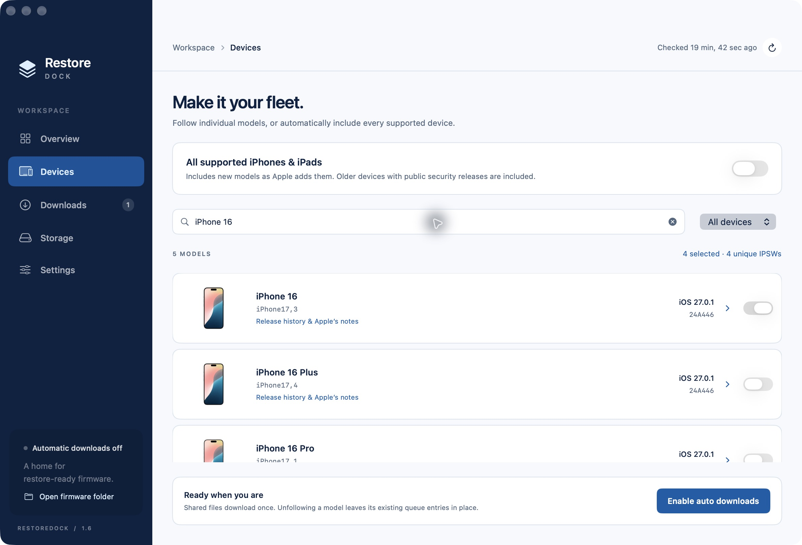
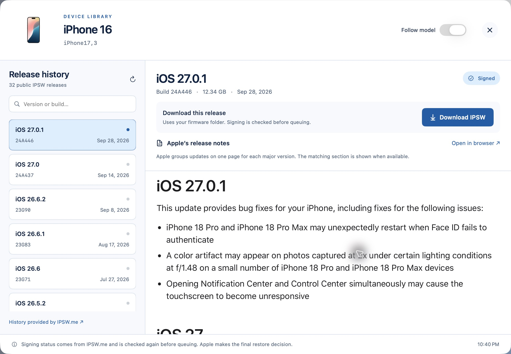
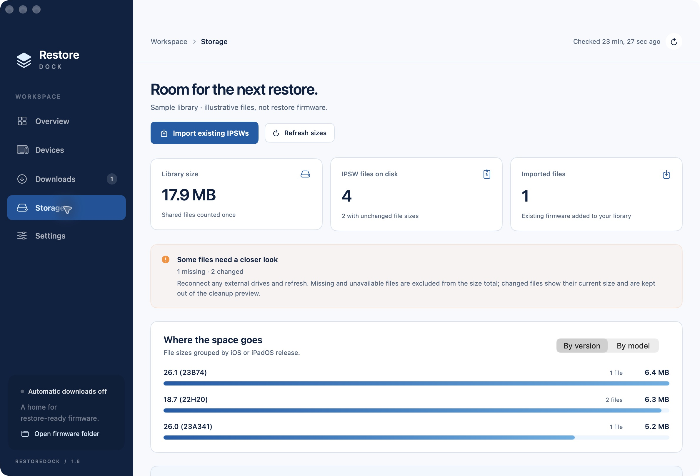
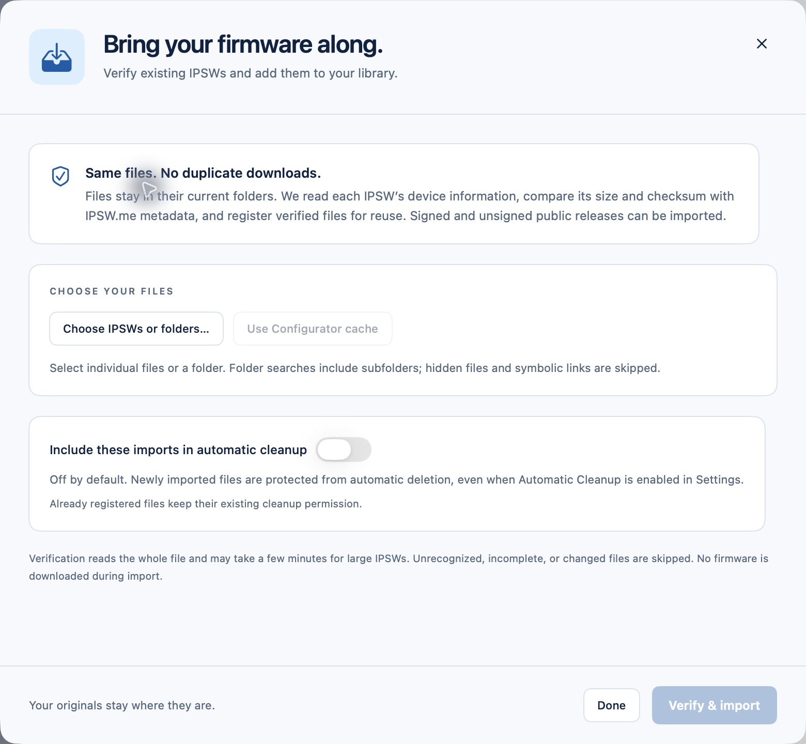

# RestoreDock

**A home for restore-ready firmware.**

RestoreDock is a native macOS app for the workbench: choose the iPhone and iPad models you restore, and keep their latest public IPSWs downloaded, verified, and ready. Bring in your existing firmware library, see what uses space, and decide what to keep.

[Download for macOS](https://github.com/hnkabraham/RestoreDock/releases/latest) · [User guide](docs/USER_GUIDE.md) · [Build from source](#build-from-source)

**macOS 14+ · Apple silicon & Intel · SwiftUI · No account required**



## Ready for your next restore

- **Follow your models.** Pick individual iPhones and iPads, or follow all currently supported models. Check for new public releases automatically, with one download for firmware shared by multiple models.
- **Download directly from Apple.** Firmware binaries come from Apple HTTPS hosts. RestoreDock verifies their checksum and expected size when available before marking them ready.
- **Explore release history.** Browse each model’s IPSW history, read Apple’s release notes inside the app, and download older releases that are still reported as signed.
- **Reuse what you have.** Import existing IPSWs from files, folders, or the Configurator cache. Verify and register them in place without copying or moving them.
- **Understand your storage.** View usage by model or version, identify missing or changed files, and preview cleanup without deleting anything.
- **Choose your cleanup policy.** Keep older firmware by default, or opt in to permanent deletion when fresh signing data reports every linked model as unsigned. Imports are protected unless explicitly opted in.
- **Fit your workflow.** Use Apple Configurator’s cache, another folder, or an external drive. Pause and resume the queue, keep the app in the menu bar, and optionally open it at login.

## Take a look

| Release history | Storage breakdown |
| --- | --- |
|  |  |
| Choose a release, inspect signing status, and read Apple’s notes. | Usage by model or version, with a read-only cleanup preview. **This screenshot uses sample library data.** |



*Import verifies existing files and adds them to the library where they are. New imports are protected from automatic cleanup by default.*

## Get started

1. Download the ZIP from [Releases](https://github.com/hnkabraham/RestoreDock/releases/latest), extract it, and move **RestoreDock.app** to Applications.
2. Open **Devices** and follow the models you restore.
3. Choose a destination in **Settings**. RestoreDock uses the Configurator firmware cache when it already exists; otherwise fresh setups use `~/Downloads/RestoreDock/`.
4. Enable automatic downloads. The default check interval is six hours. Leave the app open; closing its window keeps the menu bar companion running.

Checks and downloads run while the app is open and your Mac is awake. An optional login setting helps keep it available. Use **Storage → Import existing IPSWs** to register files you already have.

The downloadable app is **ad-hoc signed and not notarized**. macOS may require you to approve opening it in **System Settings → Privacy & Security** after the first attempt. Only do so for a copy you trust. You can also build the app locally.

## Build from source

Install Xcode with the macOS SDK and Swift 5.9 or later. From the repository root:

```sh
./build-app.sh
```

This builds a universal app for Apple silicon and Intel, signs it locally, and creates:

```text
dist/RestoreDock.app
dist/RestoreDock-macOS.zip
```

Open `Package.swift` in Xcode to work on the source. Use the packaged app for menu bar integration, notifications, and Open at Login. Organizations can apply their own Developer ID signing and notarization to their builds.

Run the tests:

```sh
export CLANG_MODULE_CACHE_PATH="$PWD/.build/ModuleCache"
export SWIFTPM_MODULECACHE_OVERRIDE="$PWD/.build/ModuleCache"
swift test --disable-sandbox --build-system native --cache-path "$PWD/.build/cache"
```

The suite covers catalogs, download validation and persistence, historical releases, imports, storage accounting, and conservative cleanup decisions. An optional live metadata test is documented in the [user guide](docs/USER_GUIDE.md#tests); it downloads no firmware. A complete multi-GB IPSW transfer has not yet been exercised as part of release validation.

## A few things to know

- **Signing can change.** History and cleanup use IPSW.me’s reported signing status. Apple makes the final decision when you restore; having an IPSW does not guarantee that it remains restorable.
- **Cleanup is an explicit choice.** It is off by default and, when enabled, permanently deletes eligible files without using Trash. Unknown or conflicting signing data keeps a file. [Read the cleanup rules](docs/USER_GUIDE.md#automatic-cleanup).
- **Configurator still manages its cache.** RestoreDock can save IPSWs there, but automatic cache recognition has not been verified. [Configurator details](docs/USER_GUIDE.md#apple-configurator-folder).
- **Storage totals are logical file sizes.** Shared files count once in the library total. APFS clones, compression, and other hard links can affect the space actually reclaimed. [Storage details](docs/USER_GUIDE.md#storage-breakdown-and-cleanup-preview).

## Sources and privacy

Apple supplies the latest-release catalogs and all firmware downloads. [IPSW.me](https://ipsw.me/) supplies model names, release histories, signing status, historical checksums, and the bundled product photos. Apple Support supplies the embedded release notes. Relevant model identifiers are sent to IPSW.me when a feature needs their metadata.

RestoreDock has no analytics, user accounts, or cloud synchronization. See the [user guide](docs/USER_GUIDE.md#sources-and-privacy) for data sources, local storage, and compatibility with earlier versions, and [third-party notices](THIRD_PARTY_NOTICES.md) for photo attribution.

RestoreDock is an independent project and is not affiliated with or endorsed by Apple or IPSW.me. Third-party images and trademarks remain the property of their respective owners.
